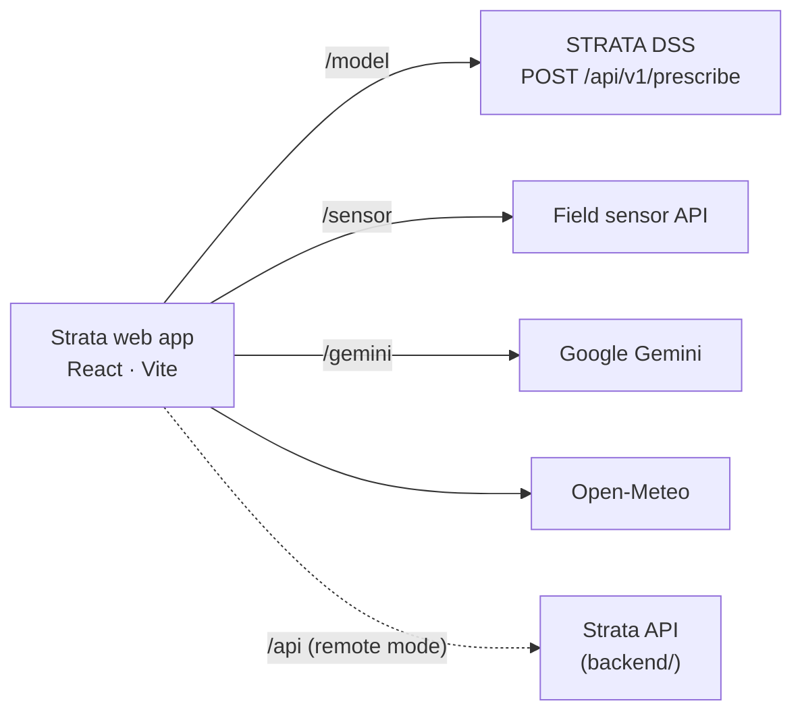

<div align="center">

# Strata

**A climate-smart planting adviser that fits in a farmer's pocket.**

Strata helps rice, corn and tobacco farmers in Valencia City, Bukidnon pick the best day to plant.
It combines a crop-climate model, live weather and an in-field sensor, and explains the answer in
plain English, Filipino or Bisaya.


</div>

---

## Table of contents

- [Overview](#overview)
- [Features](#features)
- [How it works](#how-it-works)
- [Repositories](#repositories)
- [Tech stack](#tech-stack)
- [Getting started](#getting-started)
- [Configuration](#configuration)
- [Project structure](#project-structure)
- [Data sources](#data-sources)
- [Roadmap](#roadmap)

## Overview

Planting is the riskiest decision of the season. Plant before the rains settle or just ahead of a
dry spell, and the whole crop can fail. Strata turns climate data into one clear answer: *when should
I plant, and why?*

The app is designed **mobile-first** for the phones farmers already carry. Its large type, simple
language and voice read-aloud make it usable in the field.

## Features

| | Feature | What it does |
|---|---|---|
| 🌱 | **Guided crop setup** | Pick a crop, pin the field on a map, and choose a planting window in three steps. |
| 📅 | **Best day to plant** | The STRATA model rates the chosen window (high, moderate or low likelihood), gives a climate-compatibility score, and suggests the most compatible date. Each result comes with plain-language reasons. |
| ⛅ | **Live weather** | 16-day forecast from Open-Meteo. If it's offline, the app falls back to a NASA POWER climatology forecast. |
| 📡 | **Field sensor** | Water level, soil moisture, soil temperature and battery from an in-field device, plus alternate wetting and drying (AWD) irrigation alerts. |
| 💬 | **Ask Tata** | A farming assistant powered by Google Gemini that knows your farm's context. |
| 🌏 | **Three languages** | English, Filipino and Bisaya (Cebuano) throughout the app. |
| 🧑‍🌾 | **Community** | A local feed for farmers and technical advisers, with barangay filters and photo posts. |
| 🧪 | **Farm tools** | Fertilizer alerts, season outlook, activity logs, and simple or detailed dashboard views. |
| 🔊 | **Voice** | Read-aloud and dictation through the browser's Web Speech APIs. |

## How it works



The Vite dev server proxies every external service. This avoids CORS issues, and secrets such as the
Gemini API key stay on the server and never reach the browser. If the sensor or the weather feed
can't be reached, the app keeps working on simulated or climatological data.

## Repositories

| Repository | Role |
|---|---|
| **This repo** | The Strata web app (`frontend/`) and a prototype FastAPI service (`backend/`) for farm profiles, logs and community posts. |
| [**Kurty-byte/NSAC---STRATA-Backend**](https://github.com/Kurty-byte/NSAC---STRATA-Backend) | **STRATA Decision Support System.** A FastAPI service that scores planting windows for corn, rice and tobacco against 2016–2025 NASA POWER weather for Valencia City, using FAO EcoCrop-informed rule models (Strata v4). It powers the planting recommendation. |

## Tech stack

- **Frontend:** React 19, Vite 8, Tailwind CSS 4, Leaflet (maps), Chart.js (sensor charts), React Day Picker
- **Backend:** Python, FastAPI, SQLite
- **Model service:** [STRATA DSS](https://github.com/Kurty-byte/NSAC---STRATA-Backend) (FastAPI, Pydantic v2)
- **AI:** Google Gemini (`gemini-3.5-flash` by default)
- **Tooling:** Oxlint

## Getting started

### Prerequisites

- **Node.js** 20.19+ or 22.12+
- **Python** 3.10+ (only if you run a backend locally)

### 1. Run the web app

```bash
cd frontend
npm install
npm run dev            # http://localhost:5173
```

You can also run `npm start` from the repository root. For the intended experience, open the app in
a phone-sized window or in your browser's device mode.

By default the app runs in **mock mode**: data lives in the browser's `localStorage`, so you don't
need a local backend.

### 2. Run the STRATA model locally (optional)

The app uses the hosted model through `MODEL_BASE_URL`. To run the model yourself:

```bash
git clone https://github.com/Kurty-byte/NSAC---STRATA-Backend.git
cd NSAC---STRATA-Backend
python -m venv .venv && source .venv/bin/activate
pip install -r requirements.txt
uvicorn app.main:app --reload --port 8001   # docs at http://127.0.0.1:8001/docs
```

Then set `MODEL_BASE_URL=http://127.0.0.1:8001` in `frontend/.env`. Port 8001 avoids a clash with
the Strata API, which runs on 8000.

### 3. Run the Strata API (optional)

```bash
cd backend
python -m venv .venv && source .venv/bin/activate
pip install -r requirements.txt
fastapi dev main.py                         # http://127.0.0.1:8000
```

Then start the frontend with `VITE_API_MODE=remote npm run dev`.

## Configuration

Settings live in `frontend/.env`; see `frontend/.env.example` for a template. Put secrets in
`frontend/.env.local`, which git ignores.

| Variable | Default | Purpose |
|---|---|---|
| `VITE_API_MODE` | `mock` | `mock` keeps data in the browser. `remote` uses the Strata API on `:8000`. |
| `MODEL_BASE_URL` | hosted tunnel | Base URL of the STRATA DSS model service. |
| `SENSOR_API_URL` | hosted tunnel | Base URL of the field sensor API. |
| `SENSOR_TUNNEL_TOKEN` | — | Access token, needed only if the sensor tunnel is private. |
| `VITE_SENSOR_DEVICE_ID` | `FS-NE-0012` | The sensor device to read. |
| `GEMINI_API_KEY` | — | Enables Ask Tata. Put it in `.env.local`. |
| `VITE_GEMINI_MODEL` | `gemini-3.5-flash` | Overrides the Gemini model. |

## Project structure

```
.
├── frontend/
│   ├── src/
│   │   ├── api.js            # API client: in-browser mock or remote FastAPI
│   │   ├── mock/             # In-browser backend with the same routes and response shapes
│   │   ├── context/          # App state: farm, season, logs, sensor, chat, navigation
│   │   ├── lib/              # Model client, weather, planting maths, Gemini, i18n helpers
│   │   ├── i18n/             # Filipino (fil) and Bisaya (ceb) translations
│   │   ├── hooks/            # useApi, useSensor, useMedia
│   │   ├── components/       # Header, tab bar, sheets, Tata, UI primitives
│   │   └── pages/            # Home and analysis, crops, chat, community
│   └── vite.config.js        # Dev proxies: /api, /model, /sensor, /gemini
└── backend/
    ├── main.py               # FastAPI app, CORS, routers
    └── app/
        ├── data.py           # Crops, provinces, climate baseline, rotation plans
        ├── db.py             # SQLite persistence
        ├── engine/           # Climate scenarios and plan scoring
        └── routers/          # /api/meta, /farm, /climate, /plans, /season, /logs, /posts, /chat
```

## Data sources

- **[NASA POWER](https://power.larc.nasa.gov/):** daily weather for 2016–2025, used by the STRATA model and as the weather fallback.
- **[Open-Meteo](https://open-meteo.com/):** free 16-day forecast; no API key needed.
- **FAO EcoCrop:** crop climate requirements behind the Strata v4 screening models.

## Roadmap

- [ ] Installable PWA: add a web app manifest and a service worker for offline use
- [ ] Real user accounts in place of the single local profile
- [ ] Deploy the STRATA model service so it no longer depends on a development tunnel
- [ ] Production ingest for field sensor devices
